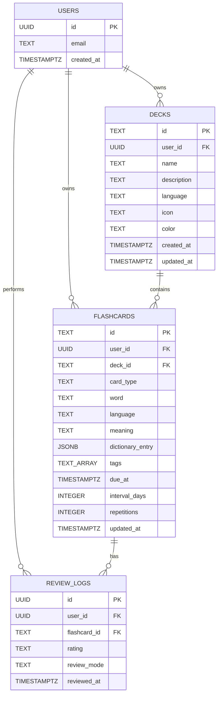

# Meoini Database Entity Relationship Diagram

## 1. Overview

This diagram illustrates the relationships between the four main database tables:

- `users`
- `decks`
- `flashcards`
- `review_logs`

## 2. Entity Relationship Diagram

## 3. Relationship Descriptions

| Relationship | Cardinality | Description |
|---|---|---|
| Users → Decks | One-to-Many | A user can own multiple decks |
| Users → Flashcards | One-to-Many | A user can own multiple flashcards |
| Users → Review Logs | One-to-Many | A user can have multiple review records |
| Decks → Flashcards | One-to-Many | A deck can contain multiple flashcards |
| Flashcards → Review Logs | One-to-Many | A flashcard can have multiple review records |

## 4. Data Ownership

Every user-owned record is associated with a `user_id`.

The database must ensure that:

- A user can only access their own decks.
- A flashcard must belong to the same user as its deck.
- A review record must belong to the same user as its flashcard.
- Deleting a user removes their associated data.

## 5. Design Notes

- Deck IDs are scoped to users through the composite primary key `(user_id, id)`.
- Flashcard IDs are globally unique.
- Dictionary information is stored in JSONB.
- Review history is stored separately from flashcard scheduling data.
- The diagram represents the planned database structure.

---

**End of Document**
